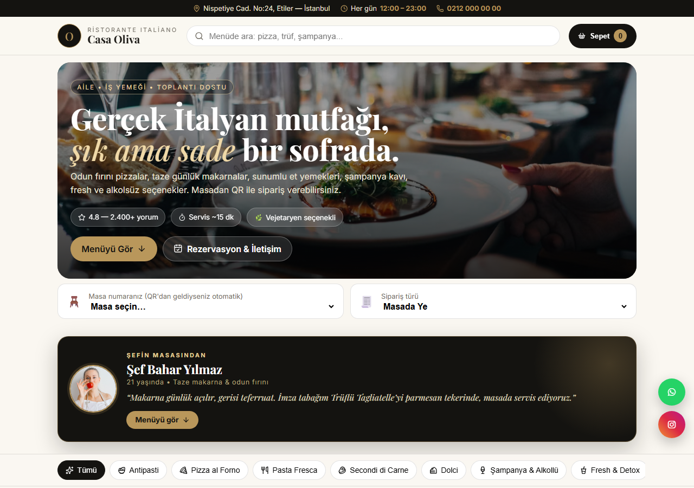
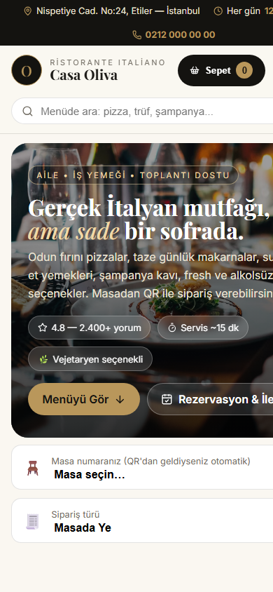
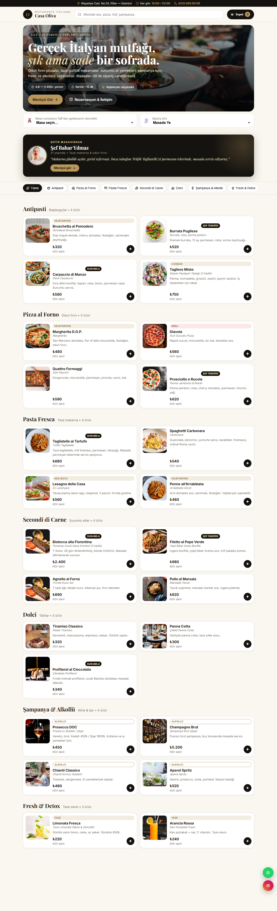

# Casa Oliva — QR Menü

Aile ve iş yemeklerine uygun, şık ama sade İtalyan restoranı için mobil uyumlu QR menü sitesi. Tek dosyalık, kurulum gerektirmez: `index.html` dosyasını açmak yeterli.

## Ekran Görüntüleri

| Masaüstü | Mobil |
|---|---|
|  |  |



## Özellikler

- **8 kategori, 30 ürün:** Antipasti, Pizza al Forno, Pasta Fresca, sunumlu et yemekleri (Secondi di Carne), Dolci, Şampanya & Alkollü, Fresh & Detox, Alkolsüz
- **Sepet + masadan sipariş:** ürün ekle/çıkar, masa numarası, paket/masada-ye seçimi, alerji ve pişirme notu, %10 servisli otomatik toplam
- **QR desteği:** `index.html?masa=M12` adresiyle QR üretilince masa numarası otomatik dolar
- **Canlı arama + kategori filtreleri**, yapışkan kategori barı
- **Şef tanıtım bandı** (Şef Bahar Yılmaz)
- **Sonner tarzı bildirimler**, scroll animasyonları, alttan kayan sepet çekmecesi
- **Yüzen WhatsApp ve Instagram butonları**
- Sepet `localStorage`'da saklanır; sayfa yenilense bile korunur

## Kullanım

1. Bu klasörü bir static hostinge yükleyin (GitHub Pages, Netlify, Vercel…) — `sef-bahar.jpg` dosyasını `index.html` ile birlikte yüklemeyi unutmayın.
2. Her masa için `https://siteniz.com/?masa=M1`, `?masa=M2` … şeklinde QR kod üretin.
3. Müşteri QR'ı okutur, menüyü görür, sepetten siparişi mutfağa gönderir.

Yerel önizleme için `index.html` dosyasına çift tıklamanız yeterli.

## Teknolojiler

Saf **HTML + CSS + JavaScript** (framework yok). İkonlar: Lucide (+ sosyal butonlarda Font Awesome). Fontlar: Playfair Display, Inter, Poppins (Türkçe `latin-ext` destekli).

## Dosya Yapısı

```
├── index.html            # Tüm site (menü verisi <script> içindeki MENU dizisinde)
├── sef-bahar.jpg         # Şef portre fotoğrafı
├── screenshots/          # README ekran görüntüleri
└── README.md
```

Fiyat veya ürün değiştirmek için `index.html` içindeki `MENU` dizisini düzenlemeniz yeterli.
